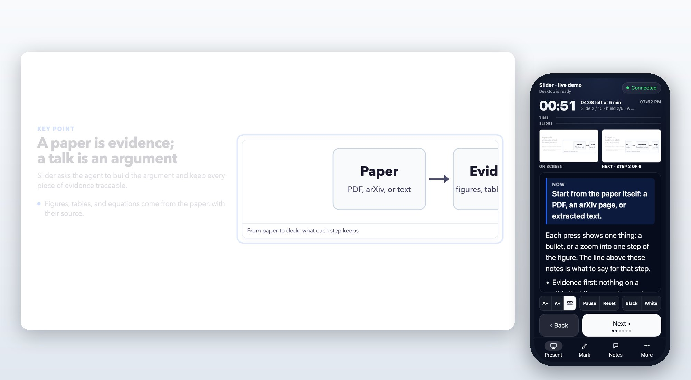
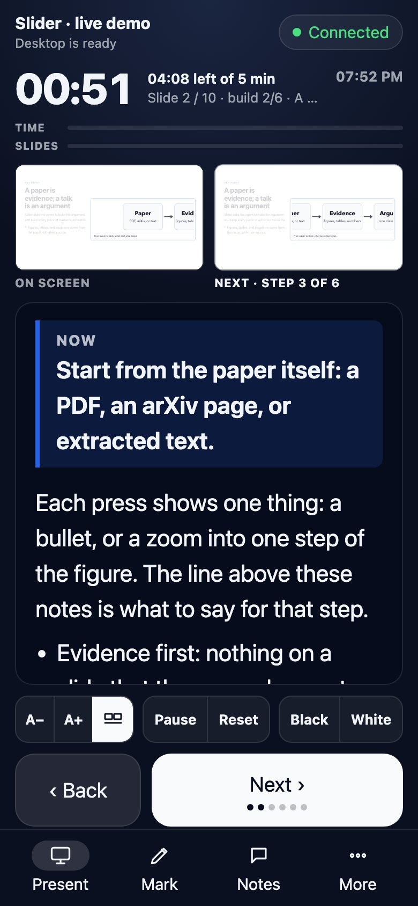

# Slider

**把論文做成一場可以用手機操控的簡報。**

Slider 是給 Codex、Claude Code、Gemini CLI 與 ChatGPT 使用的 agent skill。把論文的 PDF、arXiv 連結、DOI 或標題交給 agent，再說明聽眾和時間長度，它會整理出論證順序，讓每張圖表與數字都能追回論文出處，寫好講者備註，最後交付一個用瀏覽器就能開的 HTML 檔。在簡報上按 `R`，用手機掃 QR code，手機就會顯示備註、計時與下一張投影片。

**[線上試玩](https://voidful.github.io/Slider/)** · [English README](README.md) · [安裝](#安裝與使用)



## 一分鐘試用

用筆電開啟[線上試玩](https://voidful.github.io/Slider/)，按 `R`，再用手機掃畫面上的 QR code。也可以在本機跑示範簡報，只需要 Python 3：

```bash
git clone https://github.com/voidful/Slider.git && cd Slider
python3 scripts/serve_deck.py
```

這個指令會用電腦在 Wi-Fi 上的位址開啟簡報，同一個網路裡的手機掃 QR code 就能連上。自己的簡報也一樣：`python3 scripts/serve_deck.py deck.html`。它只會分享簡報本身和簡報引用到的檔案。

## 用手機上台



手機打開的是同一個網頁，不用安裝 App。

- 講者備註用大字顯示，跟著投影幕上的投影片換頁
- 依照演講時長計時；剩 5 分鐘、2 分鐘時時鐘會閃，Android 手機也會震動
- 同時看到投影幕上的畫面，以及下一個漸進出現的項目或下一張投影片
- 大顆的上一步、下一步按鈕，也可以在備註上左右滑動換頁
- 問答時可以讓投影幕全黑或全白；也能在投影片上畫重點，或把一段文字推到投影幕
- 手機橫拿時，備註在左邊，按鈕在右邊

配對會先經過公開的 PeerJS 伺服器，之後的控制資料走 WebRTC。手機用行動網路，或場地 Wi-Fi 隔離了裝置時，需要設定 TURN relay，做法見 [phone remote relay](references/artifact-rendering.md#phone-remote-relay)。掃過 QR code 的人都看得到你的講者備註，只分享給一起上台的人。

<br clear="right">

## 用說的修改，從提問開始

- **先問再做**：如果你沒說報告多長、給誰聽、聽眾該記住什麼，agent 會先一次問一題，問清楚才開始做。說「直接做」就會跳過。
- **指出來，再交給 agent**：在簡報上按 `E`，點選要改的地方，寫下想怎麼改。Slider 會把所有要求整理成一段 prompt，附上投影片、欄位和目前的文字，複製後直接貼給 agent。雙擊文字可以當場改錯字，這個修改也會寫進 prompt，讓 agent 那邊的內容保持一致。（完整的版面編輯器還在指令選單裡。）
- **用動態講解**：投影片可以帶著聽眾看圖：每按一次，就放大下一個區塊，或把下一列、下一個數字打亮，其他地方變暗；手機上同時顯示這一步要講的那句話。跳頁、列印和總覽永遠顯示完整的投影片。

## 安裝與使用

在 Codex 裡，把整個資料夾放進專案的 skill 目錄：

```bash
mkdir -p .agents/skills
git clone https://github.com/voidful/Slider.git .agents/skills/slider
```

想在每個專案都能用，就改放到 `~/.agents/skills/slider`。`scripts/`、`references/`、`assets/`、`agents/` 要和 `SKILL.md` 放在一起。Claude Code、Gemini CLI 與 ChatGPT 的設定方式見英文 README 的 [Other agent platforms](README.md#other-agent-platforms)。

接著直接跟 agent 說：

```text
$slider 將這篇論文做成 10 分鐘的研討會報告，聽眾是 ML 研究者。保留核心方法圖、主要比較與限制，附講者備註。產生 HTML 後在瀏覽器檢查，修掉排版問題。
```

也可以只做其中一段：

```text
$slider 將這篇論文做成 6 張、5 分鐘的繁體中文簡報，保留核心圖表與講者備註。
$slider 修改第 4 張的用詞，並確認它還放得下。
$slider 對照論文檢查這份簡報，只列出問題，不要修改。
$slider 規劃一場 8 張投影片的報告，先停在大綱與證據對應。
```

你指定的聽眾、語言、時長、張數與格式，優先於 Slider 的預設。沒有特別說明時，它假設聽眾是研究者、長度約 15 分鐘。

## 會交付什麼

| 交付物 | 適合的情況 |
|:---|:---|
| HTML 簡報 | 預設。一個檔案，含簡報模式、編輯器、講者視窗與手機遙控 |
| React 元件 | 要把投影片放進既有的網頁應用 |
| Vite React 專案 | 要長期維護一份簡報，內容、元件與講者工具分開管理 |
| 報告規劃 | 先確認論證、節奏與證據，再開始做投影片 |
| 檢查結果 | 找出缺少證據的主張、遺漏的限制或排版問題 |

## 做得到與做不到的事

- 圖、表與方程式來自論文，並保留出處；生成的規劃仍需要你對照論文確認。
- 每張投影片在固定的 1200×675 畫布上排版。瀏覽器檢查會找出被截斷、超出畫面、互相重疊，或在不同視窗大小下排版不同的投影片；27 張刻意塞滿內容的測試投影片都要通過。
- 不會輸出可編輯的 PowerPoint 檔，產出是 HTML 或 React。
- 手機遙控需要手機連得到的網址，以及公開的 PeerJS 伺服器。

指令、驗證方式與設計細節，請看 [English README](README.md)、[SKILL.md](SKILL.md) 與 [reference index](references/README.md)。
